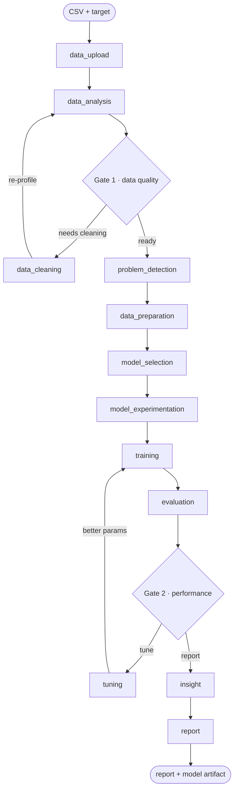

<div align="center">

# MLPilot

**An agentic AutoML platform.**
Twelve specialist agents on a LangGraph state machine turn a raw CSV into a tuned, evaluated, explained and served machine learning model.

<br/>

[](https://github.com/AyazAhmad03/MLPilot/actions/workflows/ci.yml)


<br/>

[Overview](#overview) ·
[Architecture](#architecture) ·
[Agents](#the-twelve-agents) ·
[Decision Gates](#decision-gates-and-feedback-loops) ·
[Quickstart](#quickstart) ·
[Serving](#serving-predictions) ·
[Roadmap](#roadmap)

</div>

---

## Overview

MLPilot removes the manual work between a dataset and a deployed model. Given a CSV file and a target column, it profiles the data, repairs it, frames the problem, screens candidate models, trains a champion, tunes it under a regression guard and evaluates it on held-out data. It then explains the outcome in plain English.

No stage advances on assumption. Two deterministic decision gates determine whether the pipeline may proceed, and when it may not, the work loops back automatically.

### Design principles

| Principle | What it means in practice |
| :-- | :-- |
| **Specialists, not a monolith** | Each agent owns a single stage and reads and writes one typed shared state, so every step is inspectable and independently testable. |
| **Loops, not waterfalls** | Dirty data is cleaned and re-profiled instead of crashing the run. A weak model is tuned and retrained instead of being reported as final. |
| **Grounded AI** | The LLM explains results and answers questions. It never routes the graph, never performs inference and never invents a number. Deterministic code makes every decision. |
| **CSV to endpoint** | Profile, train, tune, evaluate, report and serve within a single session, with MLflow tracking and a Streamlit interface throughout. |

---

## Architecture



---

## The Twelve Agents

| # | Agent | Stage | Responsibility |
| :-: | :-- | :-- | :-- |
| 1 | `data_upload` | Ingestion | Loads the CSV and captures the schema and target column. |
| 2 | `data_analysis` | Profiling | Reports rows, columns, data types and a per-column missing-value map. |
| 3 | `data_cleaning` | Repair | Drops unusable columns, resolves missing values, then loops back for re-profiling. |
| 4 | `problem_detection` | Framing | Classifies the problem as classification or regression and validates the target. |
| 5 | `data_preparation` | Features | Encodes and scales features and produces the train/test split. |
| 6 | `model_selection` | Shortlist | Selects candidate estimators suited to the detected problem type. |
| 7 | `model_experimentation` | Screening | Cross-validates every candidate and records `cv_results`. |
| 8 | `training` | Fit | Trains the champion model (`best_model_name`) on the prepared data. |
| 9 | `tuning` | Optimisation | Runs an Optuna hyperparameter search under a regression guard (`tuning_history`). |
| 10 | `evaluation` | Verdict | Computes held-out test metrics, including `f1_score`. |
| 11 | `insight` | LLM narrator | Summarises what won, what it cost and where the risk lies. |
| 12 | `report` | Delivery | Produces the final run report and exports the model artifact. |

---

## Decision Gates and Feedback Loops

Both gates are pure Python functions over the shared state (`core/gates.py`). No LLM is involved, which is why they are fully covered by tests and behave identically on every run.

**Gate 1 · Data quality** (after profiling)
The profile is inspected for missing values and unusable columns.

- `needs_cleaning` routes to the cleaning agent, then loops back to re-profile the repaired data.
- `ready` advances to problem detection.

**Gate 2 · Performance** (after evaluation)
The champion's held-out score is judged against the cross-validation evidence.

- `tune` routes to the Optuna tuning agent, then loops back to retrain with better parameters.
- `report` advances to the insight agent and the final report.

**Regression guard.** Within the tuning loop, every Optuna trial must beat the incumbent cross-validation score. Trials that do not are rejected and the search continues, so the pipeline never exchanges a good model for a worse one.

---

## Grounded AI

> **The LLM explains. Deterministic code decides.**

The insight agent and the chat panel use an OpenAI-compatible API, configured for Groq by default. They operate under three fixed rules:

1. **No routing.** The LLM never routes the graph. Both gates are deterministic functions of state.
2. **No inference.** Predictions come only from the exported model artifact. The LLM is never part of the serving path.
3. **No invented figures.** Every number in the insight narrative and in chat answers comes from run state (`cv_results`, `metrics`, `tuning_history` and related fields). When a fact is not in state, the agent reports it as *not recorded* rather than guessing.

The insight agent also compares cross-validation scores with the held-out test score and flags genuine generalisation gaps. For example, on a 24-row test set a drop in F1 from 0.947 to 0.833 corresponds to only two or three misclassifications, and the report states this plainly instead of relying on averages.

---

## Quickstart

### Installation

```bash
git clone https://github.com/AyazAhmad03/MLPilot.git
cd MLPilot

python -m venv .venv
source .venv/bin/activate        # Windows: .venv\Scripts\activate
pip install -r requirements.txt
```

### Configure the LLM

The insight agent and the chat panel read their settings from a `.env` file.

```bash
OPENAI_API_KEY=gsk_your_key_here
LLM_BASE_URL=https://api.groq.com/openai/v1
LLM_MODEL=openai/gpt-oss-120b
```

### Run the pipeline

Sample datasets are included in the repository.

```bash
python main.py iris_messy.csv --target target
```

The agents run end to end: profiling, cleaning loop, problem framing, screening, training, tuning loop, evaluation, insight and report. The fitted model is exported as a `joblib` artifact, ready to serve.

---

## Streamlit Cockpit

```bash
streamlit run app.py
```

A centred, single-column interface with a setup row beneath the hero, a live twelve-agent map of the pipeline, an insight card rendered directly from the LLM narrative, and a grounded chat panel for asking questions about the run.

---

## Serving Predictions

```bash
uvicorn api:app --reload
```

| Endpoint | Method | Purpose |
| :-- | :-: | :-- |
| `/health` | `GET` | Liveness check. |
| `/model-info` | `GET` | Champion model, problem type and training metrics. |
| `/predict` | `POST` | Accepts a feature-name to value JSON object and returns predictions from the `joblib` artifact. |

```bash
curl -X POST http://localhost:8000/predict \
  -H "Content-Type: application/json" \
  -d '{"sepal_length": 5.1, "sepal_width": 3.5, "petal_length": 1.4, "petal_width": 0.2}'
```

The API loads the model once at startup and re-indexes incoming payloads to the exact training feature order, which prevents silent column-mismatch errors.

---

## Experiment Tracking

Run-level parameters, cross-validation scores and final metrics are recorded with MLflow, so every pipeline run is reproducible and comparable.

```bash
mlflow ui
```

---

## Testing and Continuous Integration

```bash
pytest -v
```

Seven tests cover the behaviour that must never drift: both decision gates (cleaning versus ready routing, and tune versus report routing) and the tuning regression guard (accepting improvements, rejecting regressions). GitHub Actions runs the suite on every push.

---

## Project Structure

```text
MLPilot/
├── agents/                  # the twelve specialists
│   ├── data.py
│   ├── cleaning.py
│   ├── problem_detection.py
│   ├── preparation.py
│   ├── model_selection.py
│   ├── experimentation.py
│   ├── training.py
│   ├── tuning.py
│   ├── evaluation.py
│   ├── insight.py           # LLM narrative agent
│   └── reporting.py
├── core/
│   ├── state.py             # typed shared GraphState
│   ├── gates.py             # deterministic decision gates
│   └── config.py
├── tests/
│   ├── conftest.py
│   └── test_gates.py        # gate routing and regression guard
├── .github/workflows/ci.yml
├── app.py                   # Streamlit cockpit
├── api.py                   # FastAPI serving
├── graph.py                 # LangGraph wiring (nodes, gates, loops)
├── main.py                  # CLI entry point
├── config.yaml              # pipeline configuration
├── requirements.txt
└── iris.csv · iris_messy.csv · customers.csv   # sample datasets
```

---

## Configuration

| File / Variable | Purpose |
| :-- | :-- |
| `config.yaml` | Pipeline configuration: thresholds, model pools and tuning budget. |
| `OPENAI_API_KEY` | API key for an OpenAI-compatible provider (Groq works by default). |
| `LLM_BASE_URL` | Endpoint of the provider, for example `https://api.groq.com/openai/v1`. |
| `LLM_MODEL` | Chat model, for example `openai/gpt-oss-120b`. |

---

## Roadmap

**Delivered**

- [x] Twelve-agent LangGraph pipeline with typed shared state
- [x] Two deterministic decision gates with feedback loops (cleaning and tuning)
- [x] Optuna tuning protected by a regression guard
- [x] Model export as a `joblib` artifact
- [x] LLM insight agent with grounded narration
- [x] Grounded chat over run state
- [x] Streamlit cockpit with a live agent map
- [x] FastAPI serving (`/health`, `/model-info`, `/predict`)
- [x] MLflow experiment tracking
- [x] Pytest suite and GitHub Actions CI

**Planned**

- [ ] Dockerised one-command deployment
- [ ] Human-in-the-loop gate approvals
- [ ] Drift monitoring on served predictions
- [ ] Chat with memory across past runs (RAG over run history)

---

## Author

**Ayaz Ahmad**, final-year B.Tech student building agentic systems for real machine learning workflows.

[GitHub · @AyazAhmad03](https://github.com/AyazAhmad03)
